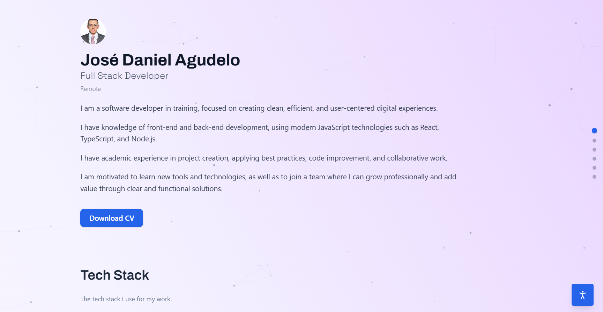

# Personal Portfolio

## Description



This project is a personal portfolio developed with React, TypeScript, and Vite, designed as a central space to showcase projects, experience, and professional approach. It prioritizes performance, simplicity, and maintainability, with full internationalization, accessibility controls, and a data-driven structure that makes it easy to update content without touching the components.

---

## Features

- Responsive single-page layout with section-based navigation
- Light and dark themes with persistent user preferences
- Internationalization (English / Spanish) driven by JSON data
- Accessibility menu: font size, font family, and optimized animation controls
- Projects section with filtering, details, and image carousel
- Work experience and education timelines
- Contact section with downloadable CV
- Loading skeletons, error boundaries, and section-level error handling
- Optimized background animations and images

## Technologies Used

- React 19
- TypeScript 5
- Vite 7
- TailwindCSS 4
- Lucide React (icons)
- Vitest & Testing Library
- ESLint & Prettier

## Available Scripts

| Command | Description |
| --- | --- |
| `npm run dev` | Start the development server |
| `npm run build` | Build for production |
| `npm run preview` | Preview the production build |
| `npm run lint` | Run ESLint |
| `npm run typecheck` | Run TypeScript type checking |
| `npm run format` | Format source files with Prettier |
| `npm run format:check` | Check formatting without writing changes |
| `npm run test` | Run the test suite with Vitest |
| `npm run test:coverage` | Run tests with coverage |

## Project Structure

```text
public/
  data/            # Content for each section (EN/ES)
src/
  assets/          # Images and static assets
  components/
    layout/        # Page and section layout
    sections/      # About, Skills, Projects, Work, Education, Contact
    skeleton/      # Loading placeholders
    ui/            # Reusable UI components
  lib/
    context/       # App settings and theme/language state
    hooks/         # Translation and data-fetching hooks
    translations/  # UI string translations
    types/         # TypeScript types
```
